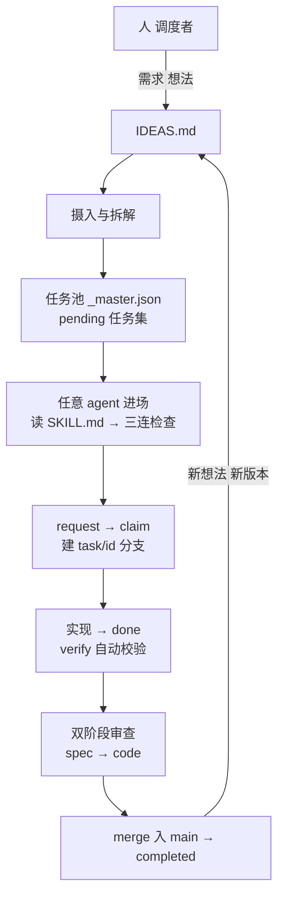
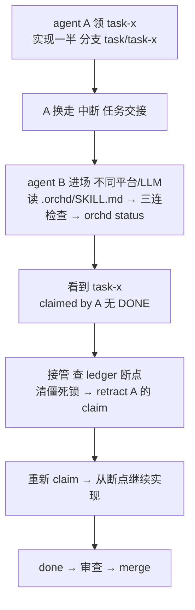

# Orchd 用户手册

> **所属线**：共用内核（跨线）（2026-09-21 两条线分线规划归位，见 ROADMAP「## 里程碑」/「## 契约演进记录」）。
> 跨线文档**不得**含版本号与排期（一律指 ROADMAP）；本文件描述的是两条线共享的内核语义与契约，不声明自有版本（版本演进见 [ROADMAP](../ROADMAP.md)，变更记录见 [CHANGELOG](../CHANGELOG.md)）。

> 面向**人**的使用指南。
> 面向 **AI agent** 的工作流规范见 [SKILL.md](../.orchd/SKILL.md)。

本手册（本文档）与 [SKILL.md](../.orchd/SKILL.md) 职责分工：

| 文档 | 定位 |
|------|------|
| **docs/user-manual.md（本手册）** | 用户指南：安装、快速开始、完整命令参考、纪律与协议、故障排查 |
| **`.orchd/SKILL.md`** | agent 工作流协议：引擎自判阶段、纪律红线、摄入协议 |

如果你是人类调度者/运维，读本手册即可；如果你是 AI agent，请先读 `.orchd/SKILL.md`。

---

## 1. 安装

要求 **Python >= 3.11**，唯一依赖为 `jsonschema`。

### 1.1 一句话让 agent 自己安装（推荐）

在项目 README.md 顶部放这一行，任何 agent 进场后自动完成安装，无需人工操作：

```markdown
> 🤖 AI agents: 用 orchd 管理本项目。如果 .orchd/ 不存在，请自动安装：
> git clone https://github.com/7bder/orchd-core.git && python orchd-core/install.py . --agent --cleanup
> 然后读 .orchd/SKILL.md 按 guidance 导航。
```

agent 会自主完成：`git clone` orchd-core → `python orchd-core/install.py . --agent --cleanup` → 读 `.orchd/SKILL.md` 进入初始化阶段 → `bootstrap` → `validate` → `init` → 项目就绪。全程**无感**：宿主项目根零额外文件、无需安装 `orchd`、无需配置 PATH（`--cleanup` 安装成功后自动删除克隆源 `orchd-core/`，宿主根零残留）。

### 1.2 手动安装（orchd-core 源码仓库 + 安装器，零根文件模型）

正式发布形态 = **orchd-core 源码仓库**（见 [release-packaging.md](release-packaging.md)）：宿主项目用安装器 `install.py` 把 orchd-core 源码组装进自身 `.orchd/` 即完成接入，宿主项目根**零额外文件**、无需安装 `orchd`：

```bash
# 1. 获取 orchd-core 源码
git clone https://github.com/7bder/orchd-core.git
# 2. 用安装器把源码安装进宿主项目
python orchd-core/install.py ./你的项目 --cleanup
cd 你的项目
python .orchd/__main__.py --version
```

> **新 agent 入口发现（AGENTS.md）**：安装器每次运行都会确保宿主根存在 `AGENTS.md`（无则新建、有则追加，幂等），内容指向 `.orchd/SKILL.md`。这让**不扫隐藏目录、无 orchd skill** 的新 agent 在宿主根即可发现引擎入口，无需依赖 `.orchd/` 这一隐藏目录或 README 指针。

> 注意：自 v1.2 起正式发布路径为 orchd-core 源码仓库 + 安装器（组装自包含 `.orchd/`），**非 PyPI**（`pip install orchd` 不再发布）。

### 1.3 安装校验

```bash
python .orchd/__main__.py --version   # 版本号来自 setuptools-scm（最近 git tag 推导）
python .orchd/__main__.py status      # 空项目首次可先 bootstrap/init 后再看
```

### 1.4 零根入口（免安装，自包含 `.orchd/`）

宿主项目无需安装 `orchd`：用安装器把 orchd-core 源码组装到项目根后（**根目录零额外文件**），全部命令走零根入口：

```bash
cd 你的项目
python .orchd/__main__.py status
python .orchd/__main__.py request
```

`python .orchd/__main__.py <子命令> ...` 与 `orchd <子命令> ...` 完全等价——入口双态自动解析引擎：发布态 vendored 于 `.orchd/orchd/`，开发态位于主项目根 `orchd/`。产物结构与接入方式见 [release-packaging.md](release-packaging.md)。

### 1.5 开发安装（仅 orchd 主项目开发者）

```bash
git clone https://github.com/7bder/orchestra.git
cd orchestra
pip install -e .
orchd --version
```

> 若命令行找不到 `orchd`，可能是用户级 Scripts 目录不在 PATH：`export PATH="$PATH:$HOME/AppData/Roaming/Python/Python312/Scripts"`（Windows）。bash 等脚本内也可统一用 `python -m orchd.cli` 形式调用。
>
> 构建产物（wheel/sdist）安装仅适用于主项目开发环境；正式发布形态为 orchd-core 源码仓库 + 安装器（组装自包含 `.orchd/`，见 §1.2），非 PyPI。

---

## 2. 快速开始

### 2.1 面向项目（推荐入口：让 agent 自己启动）

**零根文件模型**：宿主项目根零额外文件。接入 = 在项目 README.md 顶部放一行 agent 指针（见 §1.1 一句话安装），或在目标项目根放 `requirements.md`（任意来源的需求文档，人写的 / AI 对话生成 / 现有 PRD）后让首个 agent 进场：

```bash
# 可选：手动安装（不依赖 agent 时）
git clone https://github.com/7bder/orchd-core.git
python orchd-core/install.py ./你的项目 --cleanup
```

首个 agent 读 `.orchd/SKILL.md` 进入**初始化阶段**，自主完成引导：

```bash
python .orchd/__main__.py bootstrap   # 输出 master schema + architect prompt + 拆解指南
# 写 .orchd/_master.json（按 schema 与拆解指南）
python .orchd/__main__.py validate    # 校验 master，修复错误
python .orchd/__main__.py init        # 生成 snapshot + 空 ledger
```

后续 session 自动进入**日常阶段**（request → claim → 实现 → done → 审查）。每一步的下一步动作由命令响应的 `guidance` 字段自动提示，**无需记命令**。

### 2.2 面向人（CLI 直接可用）

命令一律用零根入口 `python .orchd/__main__.py`（免安装；开发安装后用 `orchd` 亦可，二者等价）：

```bash
python .orchd/__main__.py bootstrap                 # 输出 master schema + architect prompt + 拆解指南
python .orchd/__main__.py validate .orchd/_master.json
python .orchd/__main__.py init                      # 生成 snapshot + 空 ledger
python .orchd/__main__.py request                # 取一个候选任务
python .orchd/__main__.py claim --task task-x
python .orchd/__main__.py done --task task-x --changes "summary"
python .orchd/__main__.py review --task task-x --type spec --verdict APPROVED
python .orchd/__main__.py status                    # 全局快照
python .orchd/__main__.py watchdog                  # 僵死任务巡检
```

人为控制面：`python .orchd/__main__.py amend`（含显式注册通道 `--register <proposal.json>`；`--master` 仅指定待校验 master、不暗示注册）/ `force-status` / `retract`（详见 [runtime-spec.md](runtime-spec.md) §1）。

### 2.3 工作模式

orchd 不是单个 agent 的助手，而是一个由**人调度、多 agent 执行、引擎兜底**的持续协作闭环。项目装好 orchd 后，任何 agent 都能进场干活，进度永远留在项目里，不在某个 agent 的会话里。



需求进、任务出，实现并审查后合入 main，再循环迭代。三方各司其职：

| 角色 | 职责 |
|------|------|
| **人（调度者）** | 放需求/想法、确认摄入、裁决候选任务与审查结论 |
| **agent（执行者）** | 任意平台，读 SKILL 自助接入，request / claim / 实现 / done / review |
| **引擎（orchd）** | 事件溯源账本、文件锁、依赖感知任务池、两阶段审查、merge 自动化、guidance 导航 |

两个阶段：**初始化阶段**（新项目安装，见 §1/§2.1）→ **日常阶段**（日常任务工作流，含纪律与摄入协议，见 §4）。阶段由引擎按 `has_master` 判定，agent 不自判模式。

#### 特性：任意 agent 随时接入、换 agent 接续执行

这是工作模式里最值得说的一点：**今天 A agent 做了一半，明天换 B agent，接着做就行，进度不丢、不用重装、不挑平台。**



为什么能做到：

- **进度在 `.orchd/` 不在 agent 内存**——任务状态全部写入事件溯源账本（`_ledger.jsonl`）与任务分支（`task/{id}`），任何 agent 进场跑一次 `status` 就能重建全局视图，换人零丢失
- **不挑 agent、不挑 LLM**——agent 只通过 orchd CLI 交互（JSON 输出），`.orchd/SKILL.md` 是纯文本协议，任何平台都能读；不写平台专属插件
- **换手三态**：A 中断（B 接管续作）/ A 完成（B 领新任务或审 A 的任务）/ A 半途交接（B 从断点续作）

换手给 B 的操作提示：通知 B "读 `.orchd/SKILL.md` + 跑 `orchd status`" 即可自助接入；若 A 是中断离开，B 按 [SKILL.md](../.orchd/SKILL.md) 的接管流程（查断点 → retract → 重新 claim）从断点继续。新式 flock 活性锁由内核托管，A 进程异常退出后锁会被引擎自动清理（OS 探活判定 stale），通常无需手工清锁；仅旧纯 JSON 锁或活锁场景才需人工介入。

#### 特性：单机多 worktree 并行（1.4，multi-worktree-m-p1）

仓库可开多个 worktree 并行推进多个任务（各任务一个 worktree），大幅提升并发吞吐：

- **任务 worktree 引擎自动**：每任务一个 worktree（`task-<id>/`），claim 自动创建 + 绑定、终态自动回收、孤儿惰性清理——agent **零 worktree 管理操作**，无需任何 `git worktree` 运维知识。
- **双布局兼容**：container（`main/` 子目录 + 平级 `task-<id>/` worktree，推荐）与 flat（既有项目零迁移，任务 worktree 即主工作树本身）；`orchd layout-migrate` 可选迁移。
- **共享账本**：各 worktree 共享同一账本根（ledger / checkpoint / lock / 任务绑定，container 默认 `<容器>/.orchd-runtime/`，或统一设 `ORCHD_HOME`），所有 worktree 的 agent 看到**同一任务池与事件流**，状态实时一致。存储后端缺省为 SQLite（`ORCHD_STORAGE_BACKEND` 仅取 `file` / `sqlite`，非法取值启动即 E007）。
- **merge 在主工作树内执行**：code APPROVED 的 merge 由引擎在**主工作树**内执行（`git-common-dir` 定位），任务 worktree **永不 checkout main**；专用 merge-wt 已废弃。
- **共享文档 canonical 读取（task-canonical-workspace-docs，2026-08-25）**：IDEAS.md / ROADMAP.md / SKILL.md / conventions 等共享文档在 intake / ideas / amend 等路径统一从 **canonical 主工作树**读取（container 布局下为 `<容器>/main/`，flat 布局即本地），任务 worktree 本地 `.orchd/` 拷贝（引擎传播的 SKILL.md 等）不参与摄入/引导定位——避免 worktree 副本过期导致不一致。实现载体为 `resolve_workspace_root`：入口先经 `resolve_canonical_project_root` 解析到主工作树根，再按开发态/发布态布局规则定位文档根。
- **依赖完成级串行（E008）**：并行仅限无依赖就绪任务，依赖链保持完成级串行（上游完成/作废后下游才可领取）。

**使用限制**：① 需 `git worktree` 支持的环境；② 多 worktree 必须指向同一账本根，否则任务池分裂；③ 各 worktree 的 agent 身份（会话指纹）独立，同一指纹仍受 E011 单任务约束；④ 单 worktree（默认 flat）不受影响，行为与以往完全一致。

---

## 3. 命令参考（§3.1 表格为生成块：真源 `orchd/cli/manifest.py`，与 parser 注册面对账；用法详解见 §3.2 与 §3.5）

> 所有命令统一输出 JSON（`indent=2, ensure_ascii=False`）。顶层捕获 `OrchdError` 并转为 JSON 错误响应，exit code 为 1。
> 长文本参数（`--changes` / `--comments`）建议写入 UTF-8 文件后经 `--changes-file` / `--comments-file` 传入，规避 Windows shell 的多行解析问题。
> 调用形式统一用零根入口 `python .orchd/__main__.py <命令>`（与 `orchd <命令>` 等价，见 §1.5）。

> **stderr 提示块（task-guide-block-config，2026-08-16）**：命令的 **stdout 始终为纯 JSON**（供机器/agent/脚本解析）；人看的"下一步"提示块打在 **stderr**，紧跟 JSON 之后，以 `orchd ▸` 前缀 + 分隔线围成块状，终端中人机同时可见。示例（stderr）：
>
> ```
> ────────────────────────────────────────
> orchd ▸ 有 6 个待认领任务：现在没有活跃实现，可领取一个新任务。
> 建议执行：orchd request
> ────────────────────────────────────────
> ```
>
> 该提示块仅作人类可读引导，**不是命令结果**；解析方只应读取 stdout 的 JSON。提示块可通过 `_master.json` 顶层 `config.guidance_stderr: false` 关闭（默认 true）。
>
> **预算管理（task-guidance-block-budget-root-fix，2026-09-13）**：渲染层不做硬编码总数裁剪，命令 / read / cases 逐字完整输出；块长由 `orchd/guide.py` 的 `_BLOCK_MAX` 求和不等式（布局开销 + hint + command + read + cases ≤ 1600）单一真源管理，红线用语义截断（按点分割只装整点，装不下退化为「红线 N 条（见路径）」）。

> **无感引导（guidance 字段，task-guide-seamless-guidance，2026-08-15）**：任意命令的 JSON 响应自动附加 `guidance` 对象 `{step, command, hint}`，按当前任务状态机+当前 agent 角色推导下一步建议：
> - `step`：建议动作标识（`first_time` / `request_review` / `request_impl` / `done` / `wait_review` / `optional_cancel` / `done_all` / `check_status`）
> - `command`：可直接执行的 orchd 命令（含参数占位）
> - `hint`：一句话说明为何这么做
> - 判定顺序：无任务→`first_time`；有 `in_review` 未审→`request_review`；有 `pending` 且无活跃→`request_impl`；有当前 agent `claimed`→`done`；有 `claimed`/`done`→`wait_review`；全 `completed`→`done_all`。
>
> `guidance` 为**加法式**字段：只新增、不替换任何既有字段（如 `request` 的 `next_action`、`candidate` 均保留），已有 `guidance` 时不覆盖（幂等）；构造失败静默跳过（best-effort），绝不阻塞命令主流程。`python .orchd/__main__.py status --text` 表格末尾含"下一步"引导文字；`orchd --help` 底部含该引导契约说明。
>
> **闭环路由（task-guide-routing-docs）**：`guidance` 还可携带 `read`（知识路由：该读的规则文件路径数组）和 `template`（方法路由：该用的模板路径数组）——agent 收到 `guidance` 后按 `read` 读规则 → 按 `template` 加载模板 → 按 `command` 执行；任一字段缺失则跳过该步（不阻塞），与既有 `step`/`command`/`hint` 平铺兼容。完整闭环示例见下。

#### 闭环示例（提示 → 读规则 → 执行）

假设 `orchd request` 返回：

```json
{
  "candidate": {"task_id": "task-x", "name": "...", "files_to_edit": [...]},
  "guidance": {
    "step": "request_impl",
    "read": ["rules/intake.md", "rules/session.md"],
    "template": ["templates/implementer.md"],
    "command": "orchd request",
    "hint": "有 1 个待认领任务：现在没有活跃实现，可领取一个新任务。"
  }
}
```

照协议走三步：

1. **提示**（`step`）：当前应 `request_impl`——领取实现任务。
2. **读规则 + 加载模板**（`read` + `template`）：依次 Read `.orchd/rules/intake.md`（摄入纪律）、`.orchd/rules/session.md`（会话纪律），再 Read `templates/implementer.md`（实现者工作流模板）。
3. **执行命令**（`command`）：跑 `orchd request` 拿下一个候选。

任一字段缺失（如 `read: []` 或无 `template`）→ 跳过该步，不阻塞后续——闭环协议允许部分字段。模板文件不存在时同样降级为跳过。这样弱 LLM 也能照 `guidance` 协议逐层闭环交付。

### 3.1 命令总览表

<!-- BEGIN GENERATED: commands-user-manual -->
| 命令 | 参数 | 读写 | 锁 | 用途 |
|------|------|------|----|------|
| `validate` | - | 只读 | 否 | 校验 _master.json |
| `bootstrap` | - | 只读 | 否 | 输出分解套件 JSON |
| `init` | - | 写 | 是 | 初始化 .orchd/ 并生成 snapshot |
| `amend` | --task --files-to-edit --exempt-files | 写 | 是 | 增量更新 snapshot / 声明域补登 |
| `retract` | --event --reason | 写 | 是 | 撤回事件 |
| `force-status` | --task --status | 写 | 是 | 强制设置任务状态 |
| `merge-ack` | --task | 写 | 是 | merge_warning 人工销账 |
| `restore` | --path | 写 | 是 | 受管工作树还原 |
| `request` | --sort --phase | 只读 | 否 | 获取下一个候选任务 |
| `claim` | --task --type --confirm | 写 | 是 | 认领任务 |
| `done` | --task --changes | 写 | 是 | 报告任务完成 |
| `review` | --task --type --verdict | 写 | 是 | 提交审查结果 |
| `pool` | - | 只读 | 否 | 列出就绪池 |
| `status` | --text --audit-task | 只读 | 否 | 全局状态快照 |
| `show` | <task-id> | 只读 | 否 | 单任务卡面详情 |
| `watchdog` | --timeout --takeover --full | 写 | 否 | 僵死任务巡检 / 接管 |
| `doctor` | --path --fix --dry-run --backup-dir | 写 | 否 | git 仓库完整性检测 / 残留清理 |
| `milestone-check` | <milestone> --master | 只读 | 否 | 里程碑判据门禁 |
| `layout-migrate` | - | 写 | 是 | flat → container 布局迁移 |
| `full-regression` | - | 写 | 是 | 全量 pytest 并记录基线 |
| `ci-record` | --path | 写 | 是 | 记录远端 CI 结论 |
| `intake` | - | 写 | 是 | 提交摄入产物 |
| `roadmap-land` | <version> | 写 | 是 | ROADMAP 规划落地为 IDEAS |
| `context-digest` | - | 只读 | 否 | 必读面内容哈希 |
| `ledger-compact` | --dry-run | 写 | 是 | 终态事件归档 |
| `migrate` | --dry-run | 写 | 是 | schema 版本前移 |
| `master-archive` | - | 写 | 是 | 终态任务定义归档 |
| `storage-rollback` | - | 写 | 是 | sqlite→file 回滚 |
| `storage-recutover` | --dry-run | 写 | 是 | 回滚残留并账 |
| `git` | merge commit | 写 | 是 | git 写操作代理 |
| `ideas-archive` | - | 写 | 是 | 归档已完结 IDEAS |
| `idea` | append close confirm propose | 写 | 是 | 灵感写入门禁 |
| `ideas` | list | 只读 | 否 | IDEAS 台账只读盘点 |
| `session` | start current end | 写 | 是 | 会话生命周期 |
| `lesson` | add archive list report resolve review show stage | 写 | 是 | 经验回灌 |
| `sync` | --push --pull --compact --status --remote | 写 | 是 | 账本跨设备同步 |
| `line-sync` | - | 写 | 是 | 跨线回移通道 |
| `check` | - | 只读 | 否 | 静态门禁 ruff + mypy |
| `release` | plan run status | 写 | 是 | 发版受管通道 |
| `guards` | list check init | 写 | 否 | 宿主 guard 配置与检查 |
| `deps` | init check sync | 写 | 否 | 依赖图真源 |
| `docs` | list check write sync | 写 | 是 | 契约文档产物清单与生成 |
| `surfaces` | list validate check assemble | 写 | 是 | 落地面登记与汇总：surfaces list / validate / check / assemble |
<!-- END GENERATED: commands-user-manual -->

> **Windows 引号提示（task-feedback-verify-win-shell）**：`amend --task <id> --verify-command-file <path>` 从文件读取 verify_command（去尾换行），避免 PowerShell 向原生进程传参时吃掉内嵌双引号；与 `--verify-command` 二选一。**该选项仅 `--task` 生效**：`--register` 请把 verify_command 写入提案 JSON，显式传入会 E007 `verify_command_file_requires_task`（task-feedback-verify-file-scope）。dry-run 对 bash syntax error 判 `invalid_shell`、对 pytest rc=4 纯参数/插件错误判 `usage_error`、对 pytest INTERNALERROR 判 `internal_error`，三者均阻断并给专属 hint，不再混入 `expected_pending`。

### 3.2 核心命令详解（中英双语注记）

#### `session start` — 开启会话（Start a session）

| 命令 | 选项 | 读写 | 锁 | 用途 |
|------|------|------|----|------|
| `session start` | --agent <名> / --kind {implementer,reviewer} / --parent <session_id> / --adopt | 写 | 是 | 开启新会话并输出 session_token/session_id；lineage 硬门：--kind 取 implementer,reviewer，--parent 必须等于该任务最后一次 DONE 的会话 id，缺失/不符一律 E016（reason=kind_not_reviewer 等） |

#### `request` — 获取下一个候选任务（Get next candidate task）

```
python .orchd/__main__.py request [--capabilities "lang"] [--exclude "task-id,..."]
             [--sort importance|downstream|hours]
             [--auto-claim] [--with-context] [--max-active N]
```

- 身份由引擎按宿主注入的 `ORCHD_SESSION_ID` 自动派生为**会话稳定指纹**（12 位 hex，
  如 `a1b2c3d4e5f6`，自动化 / 无人值守会话身份锚定，见 §5.5），无需指定 `--agent`。
- `--capabilities`：能力过滤，多个用空格分隔；引号包裹的单个参数会按空白展平。
- `--exclude`：排除的任务 ID 列表（跨重试维护）。
- `--sort`：候选排序（importance / downstream / hours）。
- `--auto-claim`：候选非空时自动认领（绕过人工确认，适合无人值守）；**默认禁用**——仅当 `_master.json` 顶层 `config.allow_auto_claim` 显式为 `true`（用户明确授权）时才生效，否则返回 E032 `auto_claim_disabled` 拒绝。可与 `--with-context` 组合。
- `--with-context`：`--auto-claim` 时附加全部共享上下文。
- `--max-active`：全局活跃（claimed）任务数达到该值时拒绝再领取（无人值守容量控制）。
- **在途冲突（`config.conflict_policy`，缺省 `warn`）**：候选可能与「在途」任务（分支已有改动、尚未落
  main，含 done / in_review / force-status 悬空态，以 git 事实判定）共享文件——`warn`（缺省）下仅在候选
  加 `conflict_with`（在途条目含 `source="inflight"` / `files` / `other_status`）并**降权排序，不阻断**；
  `serialize` / `block` 下该候选进 `excluded_conflicts`（含 `blocked_by`）。非法值回退 `warn` 并在
  `degraded_guards` 留痕（不静默）。`claimed` 任务的硬排除与 policy 无关。

返回：匹配任务信息或空结果；空池会给出 `reason` / `mismatched` 说明。

#### `claim` — 认领任务（Claim a task）

```
python .orchd/__main__.py claim --task <id> [--type spec|code] [--with-context] [--confirm]
```

- `--task`（必需）。身份由引擎按宿主注入的 `ORCHD_SESSION_ID` 自动派生（会话稳定指纹），无需指定 `--agent`；审查角色由引擎按任务状态自动分流（in_review 任务 claim 即审查）。
- `--type`：reviewer 认领时指定审查阶段（spec/code），默认锁任务当前阶段。
- `--with-context`：显式附加全部共享上下文（architecture + conventions），默认按需。
- `--confirm`：确认执行认领。**无 `--confirm` 时仅输出预览**（`confirm_required: true` + 任务基本信息 / 当前状态 / git 状况 / 将执行动作 / 预期校验），**不写事件、不建分支**，防误领/误执行（确认闸门，v1.2）。

无 `--confirm` 返回预览（只读）：
```json
{
  "confirm_required": true,
  "claim_type": "implementer",
  "hint": "预览模式：确认无误后请加 --confirm 真正执行认领（写事件 + 建分支）",
  "preview": { "task_id": "...", "current_status": "pending", "git": {...}, "actions": [...], "expected_checks": [...] }
}
```
reviewer 角色预览额外含 `review_phase`（spec/code）、`reviewers` 名单、`done_by` 与 self-review 预期校验（E016）。`request --auto-claim` 为无人值守路径，内部直接执行 claim、跳过确认——但**默认禁用**，需 `config.allow_auto_claim: true` 显式授权（见 §request --auto-claim 说明）。

带 `--confirm` 成功返回 `claimed: true` + 完整任务定义 + 文件清单 + 分支名。失败返回 E008–E011 错误，需将任务 ID 加入 `--exclude` 后重新 request。

#### `done` — 报告任务完成（Report task completion）

```
python .orchd/__main__.py done --task <id> [--changes "summary"|--changes-file <path>] [--concerns ...]
```

- `--changes` / `--changes-file`：二选一，变更描述；多行建议用 `--changes-file`。
- `--concerns`：可选关切事项。

`done` 会先运行任务的 `verify_command`（120s 预算），通过后执行完整性硬门禁，再自动提交 `files_to_edit` 范围内改动并进入 spec 审查。

- 成功响应额外含 `review_handoff`（task-review-handoff-engine，2026-11-04）：引擎自动
  mint 一个 `kind=reviewer`、`parent=本任务最后一次 DONE 的 session_id` 的审查会话，并
  渲染可直接交给独立 subagent 的 spawn prompt（含 task_id/阶段/worktree/项目根/两种 token
  注入/claim&review 命令/模板/`must_read`&`reference` 清单/comments 首句/只读约束/JSON
  输出契约，**prompt 明确要求 subagent 不再执行 session start**）。comments 首句写死为
  「本审查由实现会话 `<implementer_fingerprint>` spawn 的独立 subagent 执行，审查指纹
  `<reviewer_fingerprint>`」，两枚 12 位指纹由引擎填好（取自 DONE 事件 `agent_id` 与
  mint 返回的 `fingerprint`），subagent 不再自行猜。实现会话把 `prompt` 原样交给独立
  subagent，无需再拼取号命令；审查清单
  与 `claim` 同源。失败（DONE 缺 session_id / mint 失败 / worktree 或模板路由解析失败 /
  指纹缺失）时退化为 `{"error": {code, reason, message, hint}}`，`reason` ∈
  `done_session_id_missing` / `reviewer_session_start_failed` / `handoff_render_failed`，
  以及引擎兜底的 `unexpected_exception`（未知异常）；done 语义不变，调用方据 `error`
  字段 fail-closed。

**完整性硬门禁（done-integrity-gate，2026-08-24）**：
- 声明文件必须进入任务分支 diff：`files_to_edit` 中任一文件未在任务分支提交 → 拒绝 done（返回 `missing_declared_files`，提示回任务分支补提交）。
- 主工作树不得残留任务文件脏写：main 工作树存在与 `files_to_edit` 重叠的未提交改动（跨 worktree 脏写）→ E017 `dirty_workspace` 阻断，须先提交/还原主工作树改动后重试。
- 提交零残留：`files_to_edit` 范围内仍有未提交跟踪改动 → E017 阻断（`exempt_files` 豁免文件随 done 自动提交，task-done-exempt-files-commit）。

#### `review` — 提交审查结果（Submit a review verdict）

```
python .orchd/__main__.py review --task <id> --type spec|code
            --verdict APPROVED|CHANGES_REQUESTED [--comments ...|--comments-file <path>]
```

- `--type`（必需）：`spec` / `code`。
- `--verdict`（必需）：`APPROVED` / `CHANGES_REQUESTED`。
- `--comments` / `--comments-file`：可选，审查意见。

code APPROVED 时引擎先执行 merge，merge 成功才写完成事件（completed = 实现 + 双阶段审查 + merge 入 main）。**分支生命周期（task-merge-auto-delete-branch，2026-08-15）**：`claim` 建 `task/{id}` 分支 → 实现/审查 → merge 成功后引擎 best-effort 自动删除该分支（失败静默降级，不影响 completed）；冲突路径分支保留（任务停留 in_review 供解决冲突）。agent 无需手动 `git branch -d` 清理。

**diff 完整性校验（review-merge-diff-gate，2026-08-24）**：code APPROVED 前引擎校验声明文件已全部进入任务分支 diff；缺失则拒绝 merge（E010 `file_conflict`），任务停留 in_review，避免"实现/测试未进分支"被终审放行。

#### `status` — 全局状态快照 / 单任务详情（Global status snapshot / single task detail）

```
python .orchd/__main__.py status [task-id] [--text] [--audit-merge] [--audit-task]
```

- 无参数：全局状态快照（project + tasks + summary）。
- 跟 task-id：单任务详情。
- `--text`：人类可读表格输出。
- `--audit-merge`：附加只读 merge 巡检（completed 任务对应分支未并入 main 的告警清单）。
- `--audit-task`：附加任务完整性只读巡检（completed 任务历史缺失/残留告警：`main_residual` / `historical_missing`）。

#### `sync` — 账本 git 跨设备同步（Ledger sync across devices）

```
python .orchd/__main__.py sync {--push | --pull | --compact | --status} [--remote <name>]
```

账本（`_ledger.jsonl` / `_checkpoint.json`）为本地运行时状态，不入 git——换设备 clone 后任务状态（claimed / in_review / completed 迁移历史）会丢失。`sync` 把账本进度经 git 显式共享，引擎热路径零改动。

- `--push`：**pull-first**——先拉取远端增量合并进本地（event_id 去重、时间戳稳定排序重建 checkpoint），再推送本地增量到远端 `orchd/ledger` ref（单提交、`--force-with-lease` CAS 语义）。
- `--pull`：拉取远端 `delta.jsonl` 合并进本地账本并重建 checkpoint；幂等（重复 pull 无害）。
- `--compact`：把未归档 delta 归并入 `state.json` 并清空，推送后 git 承载体积收敛到 O(任务数)。
- `--status`：只读查看远端 ref 的进度摘要（任务数 + 分状态计数），不改本地。
- `--remote`：指定远端名，默认 `origin`。

**可持续性设计**：git 承载为专用 ref `refs/heads/orchd/ledger` 的**单提交**（旧对象由 `git gc` 回收），tree 含 `state.json`（O(任务数) 紧凑任务状态表）+ `delta.jsonl`（自上次 sync 以来未归档事件尾，有界于同步间隔）——git 体积不随事件总数增长。同步语义、冲突仲裁与 gc 说明详见 [.orchd/rules/git.md](../.orchd/rules/git.md)「账本同步」节。

### 3.3 任务完整性检查

引擎在任务生命周期关键点强制校验"声明文件完整性"，并提供只读巡检命令供日常检查：

**硬门禁（不可绕过）**：
- `done`：声明文件必须进入任务分支 diff；主工作树不得残留与 `files_to_edit` 重叠的未提交改动；提交零残留（E017 `dirty_workspace`）。
- `review`（code APPROVED）：声明文件未全部进入任务分支 diff → E010 `file_conflict` 拒绝 merge，任务停留 in_review。

**只读巡检（告警不阻断）**：
- `status --audit-task`：巡检 completed 任务历史——`main_residual`（main 工作树残留声明文件未提交改动）、`historical_missing`（任务分支 diff 缺失声明文件）。
- `watchdog`：附加 `task_integrity` 字段，巡检活跃任务（claimed / done / in_review）——`main_dirty_overlap`（跨 worktree 脏写）、`missing_declared_files`（分支 diff 缺失声明文件）。

**纪律要求（agent 侧）**：
- 所有 `files_to_edit` 声明文件必须随任务分支提交（引擎 done/review 硬门禁，见 [SKILL.md](../.orchd/SKILL.md) 纪律红线）。
- 不得在主工作树直接修改任务文件——应在任务 worktree 内修改并由 done 提交；主工作树残留即 `main_dirty_overlap` / `main_residual` 告警来源。

### 3.4 doctor — 仓库健康检测与残留清理

`doctor` 是项目清洁的统一入口：只读检测（`check_repo`）+ 残留清理（`doctor_fix`）。**检测面与清理面一一映射**——每个可修复的 fail 检查项都有对应的 `--fix` 清理通道，杜绝「报得出、清不掉」的断链。

```
python .orchd/__main__.py doctor                 # 只读健康检测（有 fail → 退出码 1）
python .orchd/__main__.py doctor --dry-run       # 残留预览（有可清项 → 退出码 1，不删除任何文件）
python .orchd/__main__.py doctor --fix           # 执行残留清理（清理失败 → 退出码 1；删除前自动备份）
python .orchd/__main__.py doctor --fix --backup-dir <dir>   # 自定义备份目录
```

**检测↔清理映射表**（`check_repo` fail 检查项 ↔ `detect_residues` 残留类型 ↔ `--fix` 动作）：

| 检查项（只读） | 残留类型 | --fix 动作 |
|------|------|------|
| `worktree_stale_registry`（prunable 注册） | `stale_worktree_registry` | `git worktree prune` |
| `worktree_residual`（无 .git 登记的 task-* 目录） | `residual_dir` | `delete_dir`（空目录 rmdir，非空 `_rmtree_force` 兜底） |
| （container 布局）master/.orchd 的 flat 遗留状态文件 | `legacy_flat_residue` | 备份后 `delete` |
| （其他运行时残留） | `orphan_session_lock` / `zombie_session` / `intake_lock` / `git_tracked_lock` / `ghost_task` | 删除 / `git rm --cached` 后删除 / 引擎 admin 控制面撤回 |

**白名单位置化**（`--fix` 绝不触碰的路径分两类）：
- **源码资产**（恒保护，与位置无关）：`_master.json` / `IDEAS.md` / `IDEAS-archive.md` / `ROADMAP.md`。
- **运行时状态文件**（仅 canonical 账本根保护）：`_ledger.jsonl` / `_checkpoint.json` / `_full_regression.json` / `session-worktrees.json` / `merge-acks.json`——位于 `resolve_store_dir` 解析出的共享账本根时保护；位于 legacy 位置（container 布局下 `main/.orchd/` 的历史 flat 遗留）则属于可清残留，`--fix` 备份后删除。

**退出码约定**（脚本化感知，与只读模式语义统一）：
- 只读：任一 fail 检查项 → `1`；全部 ok → `0`。
- `--dry-run`：存在可清理项（扣除白名单保护与需人工处置项）→ `1`；无可清项 → `0`。
- `--fix`：清理存在失败项（errors 非空）→ `1`；全部成功 → `0`。

#### 3.4.1 自动清洁（读路径自动执行，用户零操作）

`status` / `watchdog` 已每次触发孤儿 worktree 清理（`prune_orphans`）；在此基础上，读路径会再执行一次**自动清洁**（`doctor.auto_clean`），把低风险残留自动清掉，用户无需手动 `doctor --fix`。分级判定与手动 `--fix` **共享 `detect_residues` 单一事实源**，检测面与清理面天然一致。

**分级模型**：

| 分级 | 残留类型 | 自动动作 |
|------|------|------|
| **Auto-Clean**（低风险，直接处理，无备份） | `orphan_session_lock` / `zombie_session` | 直接删除 |
| | `residual_dir` | 删除目录（空 rmdir，非空 `_rmtree_force` 兜底） |
| | `stale_worktree_registry` | `git worktree prune` |
| **Legacy move**（可回滚） | `legacy_flat_residue` | 移入 `.orchd/.doctor-backup/legacy/<ts>/` 滚动备份区 |
| **Manual notice**（高风险，仅报告） | `ghost_task` / `git_tracked_lock` / `intake_lock` | 仅计入 `manual_notice`，不自动执行 |

- **关闭开关**：环境变量 `ORCHD_AUTO_CLEAN=off` 或 `=report` 一键切回「只报告不执行」（结果 `disabled=True`）。
- **执行留痕与 stderr 契约**：仅对**真正发生**的清理/备份动作（含失败）写 `orchd ▸ [回收]` stderr；`manual_notice` / `reported_only` 这类未做任何清理的项不发 stderr，避免读路径噪声。同时 stderr 输出受 `config.guidance_stderr` 约束：关闭（false）时读路径零 stderr（清理照常执行但静默），结果仅并入返回 JSON 的 `auto_clean` 字段。
- **结果可见性**：有过拓扑时 `status` / `watchdog` 返回 `auto_clean` 字段（`auto_cleaned` / `auto_moved` / `manual_notice` / `disabled`）；`status --text` 转人类可读文本。

### 3.5 门禁与维护命令用法（§3.1 表中有行、§3.2 未单列详解的命令）

#### `milestone-check` — 里程碑判据门禁（只读）

```
python .orchd/__main__.py milestone-check {freeze,split-ready} [--master <path>]
```

- 判据单一真源：M1 单机内核冻结（freeze）/ M2 分线就绪（split-ready），输出 ready 或逐条 not_ready + 修复指引；退出码 0 = 达成。
- 只读命令，不写账本；`--master` 缺省指向 canonical 主工作树 `.orchd/_master.json`。

#### `ledger-compact` — 账本归档压实（发版前维护）

```
python .orchd/__main__.py ledger-compact [--dry-run]
```

- 把终态任务事件归档至 `_ledger.archive.jsonl` 并重写 checkpoint；幂等；`--dry-run` 只算搬运计划，不写任何文件。
- 账本体积治理入口；`sync --compact` 为跨设备同步的归并形态（用法见 §3.2 `sync` 段）。

#### `master-archive` — 终态任务定义归档（master 体积治理）

```
python .orchd/__main__.py master-archive [--path <master>] [--archive-path <rel>] [--dry-run]
```

- 把 master 中已终态（completed/cancelled）的任务**定义**摘入归档文件，并在 master 顶层写入 `definition_archive` 清单 `{path, count, sha256}`；归档位置只由清单 `path` 解析（相对项目根），引擎不另设默认值。与 `ledger-compact`（终态任务**事件**归档）对称：一侧治事件体积，一侧治定义体积。
- 前置：master 须已 `migrate` 到 schema v3；账本状态不可重建（缺载体/空载体）时**拒绝执行**并给修复指引——把不可用静默当「无终态任务」会让全部终态定义留在 master 且清单写成空。
- 幂等（重复执行不重复追加、既有条目逐字保留）、原子（写归档 → 重写 master 两次原子替换，失败回滚归档）、自复验（重读两文件 + 重算摘要 + 断言 master 中不再含终态定义）。`--dry-run` 只算计划，零落盘。
- 回读面（`pool` / `status` / `show` / `request` 与 `depends_on` 引用解析合并归档）见后续接续卡；`orchd migrate --retreat` 在 `definition_archive` 非空时 fail-closed 拒绝回退。

#### `migrate` — schema 版本前移（停服迁移通道）

```
python .orchd/__main__.py migrate [--path <master>] [--dry-run] [--retreat]
```

- 版本前移：`schema_version` 1 → 2 → 3。**v3 是破坏性变更**——master 顶层 `required` 增 `definition_archive`，`tasks` 语义收窄为「活跃任务定义」（终态定义由 `master-archive` 移入归档）。
- **v3 迁移恒建 definition_archive 空骨架**（master 顶层 `definition_archive` 取 `{}`）：该键是「定义归档在场」的唯一机读锚，缺席会让回读正确性依赖隐式约定；已有值（含非空清单）一律不覆盖，迁移不搬运归档内容。
- **账本零触碰**：本通道只改 master 文件本身；归档内容的搬迁属 `master-archive` 的写入通道。
- `--retreat`（target < 3）会移除该键；若它不是空骨架则 fail-closed 拒绝（回退不能静默丢弃归档指针）。`--dry-run` 只算计划、零落盘。

#### `context-digest` — 必读面指纹（跳过重读判据）

```
python .orchd/__main__.py context-digest
```

- 只读输出必读面文件的内容哈希与字节数；与上次比对一致即跳过重读，仅重读变化项（见 [SKILL.md](../.orchd/SKILL.md) 读取纪律 A1）。
- 引擎只吐哈希，跳过与否由宿主/agent 决定。

#### `full-regression` — 全量回归（发版门禁点）

```
python .orchd/__main__.py full-regression [--path <dir>]
```

- 跑全量 pytest，通过后写 `.orchd/_full_regression.json`（last_pass_commit）；失败不写通过标记。
- **日常 `verify_command` 禁跑全量**（引擎 120s 上限，只留定向子集）；全量只在发版门禁点执行（见 §5.3.1 两档策略）。

**`guards` — 宿主 guard 清单（只读）与配置面**

```
python .orchd/__main__.py guards list
python .orchd/__main__.py guards check deps
```

- 只读输出 `.orchd/shared/guards.json` 的逐 guard 模式与启用状态（`ok`/`configured`/`reason`）；无配置或空配置时全部 off（`reason=no_config`），非法配置输出结构化 errors 并非零退出。
- 配置真源 `.orchd/shared/guards.json`（schema v1）：

  ```json
  {
    "schema_version": 1,
    "guards": {
      "generated": {
        "mode": "warn",
        "artifacts": [
          {"module": "scripts.gen_contract_docs", "function": "gen_commands_md",
           "artifact": "docs/_generated/commands.md"}
        ]
      }
    }
  }
  ```

- 已接入评估器：`generated`（生成物新鲜度）——逐产物比对「生成器函数输出」与磁盘内容，只读、零子进程、超预算/生成器不可读/产物缺失一律降级留痕不阻断。
- 已接入评估器：`census`（文件/函数体量棘轮）——按宿主配置 `roots` / `file_max` / `baseline`（可选 `ratchet_roots` / `function_max` / `class_max`）扫描宿主 `.py` 并与宿主基线比对，报「已登记文件回升 / 新增文件超阈值 / 基线幽灵条目 / 棘轮根总行数回升」；非 Python 文件跳过，基线缺失视为 `not_applicable`（不误红），判据与 `scripts/file_census.py` 同源；写基线默认只许收紧，调高/新增大文件须显式 `force_raise`。
- 已接入评估器：`perf`（遥测：git spawn 计数 / g1 站点分布）——默认 off（零额外子进程）；启用后只读宿主 `perf.census` 指向的普查 JSON（`scripts/spawn_census.py` / `scripts/g1_site_census.py` 的 `--json` 产物），按 `perf.spawn_max` / `perf.probe_max` 判超限、`perf.top` 截结论里的站点行数；两个上限默认 `0`（只测量不判红，避免与实测锚量级错配），显式配正数才启用，同一 JSON 可同时含两项、被两个上限各判一次。未声明 census 或产物不可读 / 结构畸形一律降级留痕（`no_census` / `bad_census`，done 期记 `degraded_guards.status=failed` 不阻断）；spawn 侧读 `total_spawns`，probe 侧优先读 `total_probe_count`、缺键则按 `sites` 求和。采集口径与两个脚本同源（`orchd/guards/perf.py` 的 `spawn_payload` / `merge_shards`）；脚本的 `--spawn-max` / `--probe-max` 是**独立入口**（默认 0 = 只测量），与 `guards.json` 的 `perf.spawn_max` / `perf.probe_max` 互不读取；超限时脚本打印可读结论并以非零退出（不覆盖 pytest 自身的非零 rc）。两个脚本的 `--json`（别名 `--out`）缺省不落盘，只打印。
- 已接入评估器：`discipline`（测试去重/纪律）——按宿主配置 `tests_dir`（可选 `conftest`）扫描：conftest 顶层共享 fixture/helper 在其它测试文件重复定义、function/class 级 fixture 内 `git init`、`sync_orchd_core.sh` 出现在非 session/module 级作用域；缺 conftest 视为 `not_applicable`（非 pytest 仓不误红）。判据与 `scripts/check_test_dedup.py` 同源（脚本仅 CLI 外壳，退出码与报错语义不变）。
- 已接入评估器：`deps`（模块依赖方向）——按宿主配置 `deps`（依赖真源路径）与 `root`（扫描根）复用 `orchd/deps.py` 的 AST 依赖图：报「未声明边」「hard/delayed 表与 AST 分组不一致」「环」「仅被 legacy wildcards 覆盖、未在 hard/delayed 精确登记（wildcards 只作溯源记法，不放行）」，只读、零子进程；缺依赖真源/扫描根/真源不可读/语法错一律降级留痕。也可直接 `guards check deps` 单跑（CLI 只读）。
- 已接入评估器：`docs`（CHANGELOG 落地与文档漂移）——按宿主配置 `changelog` 路径、`task_pattern` 任务号正则与可选 `anchor` 锚，扫描「上一发版 tag..HEAD 已落地任务」是否出现在 CHANGELOG 全文，缺行即命中（`context.task_id` 标出任务号）；无 tag / git 不可读 / 锚之后无落地任务（或任务号正则过滤后为空）/ CHANGELOG 不可读一律降级留痕不误红，判据与引擎 merge 审计同源（回归断言见 tests/test_host_guard_docs.py::TestParityWithEngineAudit）。
- 已接入评估器：`pkg_contract`（包契约六类检查）——按宿主配置 `packages`（包 id / 点分模块路径 / 声明域 / 公开面基线 / DAG 规则 / 预算 / 补丁点，字段与引擎 `tests/pkg_contract_data.py` 的 `PackageContract` 对齐）逐包检查：包文件与声明域逐一对上、`__init__` 纯重导出且 `__all__` 与公开面逐条相等、公开名从声明域重导出（可选运行时同一对象）、禁止面未回潮、包内顶层 import 无环/叶不导编排器/必含边在场/允许边不越界、行数与聚合入口不超预算、补丁点在归属域可达；命中项带包名 id（`context.package`），只读零子进程；无配置或 `packages` 为空视为 `not_applicable`，非 Python 包（目录缺失或没有 `*.py`）跳过不误报，配置非法/扫描不可读降级留痕。判据与引擎 `tests/test_pkg_contract.py` 同源，也可 `guards check pkg_contract` 单跑。
- 已接入评估器：`lanes`（测试快慢车道台账）——按宿主配置 `ledger`（台账相对路径，缺省 `tests/STABLE_LANES.md`）、`ci`（CI 工作流，缺省 `.github/workflows/ci.yml`）与可选 `stable` / `fast`（车道成员声明；声明后台账清单须逐条一致，删条目/私加条目都会逐条命中）校验：Stable/Fast 条目文件存在、无重复、台账头含晋升/降级规则说明、Fast 节唯一且预算锚与常量一致、CI `test-slow` 消费台账清单且发版闸门 job 跑真全量；缺台账视为 `not_applicable`（不误红），台账不可读/非 UTF-8/配置非法一律降级留痕。判据与 `scripts/update_stable_lanes.py` 同源（脚本仅 CLI 外壳，`--check` 输出契约与退出码不变），也可 `guards check lanes` 单跑。宿主没有 CI 工作流（如 `.github/workflows/ci.yml`）时，guard 跳过 CI 接线段不误红；`scripts/update_stable_lanes.py --check` 对缺 CI 仍报 `ci_missing`（脚本面向引擎仓，宿主以 guard 为准）。
- 已接入评估器：`drift`（真源→镜像 / 共享入口覆盖）——按宿主配置 `entries`（`[{"source": "orchd/cli/parser.py", "mirrors": ["docs/_generated/commands.md"]}]`，路径相对仓库根、禁绝对路径与 `..`）校验「源文件改动当批须同时改动其镜像」：镜像全缺 → `class=generated` 硬缺口、部分缺 → `class=mirror_partial`（warn 档仅提示，hard 档与 `generated` 同属阻断；findings 的 `context.blocking` / `context.mode` 带出档位语义）；`shared_entries`（`{"orchd/cli/__init__.py": ["tests/test_cli_workflow.py"]}`，键与测试路径均相对仓库根、禁绝对路径/盘符/`..`，键以 `/` 结尾视为包前缀）校验「入口改动当批的 `verify_command` 须覆盖登记的测试文件」，否则报 `required_test`。findings 的 `context.rule` 为 `drift_closure` / `shared_entry_verify`，硬档 E039 的 `details.rule` 仍是配置里的 guard 名 `drift`。只读、零子进程；未配置时不执行，配置了但两个选项皆空时降级留痕不阻断。判据与引擎内建 drift closure（`orchd/drift_closure.py`）及共享入口门禁（`orchd/shared_entries.py`）同源，也可 `guards check drift` 单跑。
- 已接入评估器：`subdomain`（子域完备性）——按宿主配置 `roots`（扫描根，多根互不越界）、`packages`（作用域包：包内每个 `.py` 须登记进 `modules` 或写决策理由）、`other_packages`（包级理由，任意深度新建包须补理由）、`top_level`（`<root>/*.py` 逐文件理由）与可选 `registered_modules`（登记面：所列文件必须存在）扫描：报「未决策模块 / 未决策包 / 命名空间目录 / 未决策顶层模块」与「登记面指向磁盘不存在对象（防守空）」；未配置或 `roots` 为空视为 `not_applicable`（不误红），配置非法/扫描异常降级留痕，只读零 git 零写盘。判据与引擎 `orchd/subdomain_census.py` 同源（宿主 guard 直接复用其五条纯只读判据），也可 `guards check subdomain` 单跑。
- 已登记但尚无评估器的 guard 名可先写进配置（done 期留痕「尚无评估器」），评估器随 host-guard-* 卡接入；**未在 `GUARD_NAMES` 登记的名字属配置错误**（`guards list` fail-closed 报 `unknown_guard`）。
- done 期分派：off 不执行、warn 只写 `degraded_guards`、hard 复用 E039 且 `details.rule=<guard>`；无配置时零行为变化（回归面见 tests/test_host_guard_wiring.py、tests/test_host_guard_generated.py、tests/test_host_guard_census.py、tests/test_host_guard_docs.py、tests/test_host_guard_discipline.py、tests/test_host_guard_deps.py、tests/test_host_guard_pkg_contract.py、tests/test_host_guard_lanes.py 与 tests/test_host_guard_subdomain.py、tests/test_host_guard_drift_entries.py）。

---

#### `release` — 发版受管通道（Managed release channel）

```
python .orchd/__main__.py release plan|status|run --tag <tag>
```

- **新增可选通道，不含 push**：只编排「跑全量回归 → 落发版凭据并提交 → 发版就绪校验 → 记录基线 → 本地打 tag」，**不执行 push**；push 仍由项目管理员手动执行。
- **不改逃生口**：不改 `.githooks/pre-push` 判定、不移除 `git push --no-verify`、不移除账本专线 skip、不替代裸 `git push`。
- `release plan`：dry-run，打印固定步骤序列（preflight→surface-check→full-regression→release-ready→baseline→tag）与将复用的既有入口，零副作用。
- `release run --tag <tag>`：逐步执行，每步原子写凭据 `.orchd/_release_state.json`（step/status/时间/证据/错误），默认分支经 `ensure_committed` 提交。前五步接既有入口：`orchd status` / `orchd surfaces check --require-assembled`（只读共享面汇总检查，未汇总即失败）/ `orchd full-regression` / `scripts/check_release_ready.py <version>`（tag 去 v 前缀）/ `scripts/check_test_baseline.py --record .orchd/test_baseline.json -- tests/ -n 8 --max-worker-restart=5`（与 pre-push 权威参数逐字同参）。
- `release status`：只读显示上次各步状态与失败停点。
- **失败停点 + 幂等续跑**：任一步失败即停在该步并记 `failed_step`；同一 tag 重跑跳过已成功步、从失败步续跑。
- **tag 步只读验证**（不代打）：`git rev-parse` 双查 tag 指向与 HEAD——tag 不存在记 `awaiting_admin`（凭据含待执行指令 `git tag <tag>`，不算 failed）；重跑时该步重执行，管理员打完 tag 后重跑即转 ok 收尾；tag 异 HEAD 记 failed。

#### `surfaces` — 共享面登记与汇总（Shared surfaces registry）

```
python .orchd/__main__.py surfaces list|validate|check [name] [--require-assembled] [--json]
python .orchd/__main__.py surfaces assemble [name] [--dry-run] [--keep-fragments]
```

- 注册表 = 引擎默认（`orchd/surfaces.py`）+ 宿主 `.orchd/shared/surfaces.json`；旧 `guards.docs.changelog`
  仅在显式配置时兼容，与宿主 overlay 冲突视为配置错误（E007）。
- `surfaces list`：列出 name / mode / path / required / 来源（engine 或 host）。
- `surfaces validate`：校验注册表（未知 mode、绝对路径、`dir` 与 `path` 重叠、filename 模板缺
  `{task_id}`/`{category}`、重复 path、宿主与旧配置冲突）。
- `surfaces check [name] [--require-assembled]`：只读校验片段格式与重复、generated 生成器分派、
  serial 声明；`--require-assembled` 存在未汇总片段即退出码 1 并给出 `surfaces assemble` 提示。
- `surfaces assemble [name]`：仅在默认分支、干净工作树、共享面未被在途任务声明时执行；先规划后写、
  失败按字节回滚；按 categories 顺序插入缺失条目并保留原 EOL/BOM，成功后删除已汇总片段；
  `--dry-run` 不写盘，`--keep-fragments` 保留片段。
- 任务侧写 CHANGELOG 一律用 `done --changelog-category/--changelog-summary`（或通用
  `--surface-entry '{"surface":"changelog",...}'`）交片段，不再把 `CHANGELOG.md` 写进
  `files_to_edit`；发版 `release run` 在 full-regression 前有只读 `surface-check`。详见
  [`.orchd/rules/surfaces.md`](../.orchd/rules/surfaces.md)。
- generated 面刷新（如 `file-census-baseline.json`）：任务内用
  `amend --task <id> --refresh-surface <面名> --reason "<...>"` 声明（仅 pending/claimed，
  `--remove-refresh-surface` 撤回）；done 的提交范围自动包含该生成物。刷新卡的 verify
  应先跑生成器（如 `python scripts/file_census.py --write`）再跑 `--check` / `docs check`，
  引擎只负责把产物纳入提交，不替任务执行生成器。设计见 `docs/shared-surfaces.md` §10.4。
- 帮助文本与 argparse 逐字一致：组 help「落地面：surfaces list / validate / check / assemble」；
  子命令 help「列出落地面（mode/path/required/来源）」「校验落地面注册表」
  「校验片段/汇总状态（--require-assembled 时存在未汇总片段即失败）」「汇总未装配片段进主文件」。

### 3.6 docs 产物清单与宿主侧策略

`docs` 产物的登记真源是 `orchd/docs_manifest.py`（`kind` 取 `file` / `block`，`host` 取 `engine-only` / `host-optional` / `host-required`）；`docs check` 的判据见 `orchd/cli/commands/docs.py`。引擎仓内 `docs check` 用生成器逐产物对拍（`mode=engine-generated`）；宿主布局只读比对安装器快照 `.orchd/.install-manifest.json` 的 sha256（`mode=host-snapshot`），**不执行任何生成器、不写盘**。

**7 个 file 产物**

| 产物 id | 产物路径（相对 `.orchd/`） | host 策略 | 宿主 `docs check` 结果 | 原因 |
|---|---|---|---|---|
| `error-codes` | `docs/_generated/error-codes.md` | 分发（`host-optional`，安装器预生成快照） | `checked`，对拍一致 | 安装器清单登记 sha256，磁盘内容一致 |
| `commands` | `docs/_generated/commands.md` | 分发（同上） | `checked`，对拍一致 | 同上 |
| `fields` | `docs/_generated/fields.md` | 分发（同上） | `checked`，对拍一致 | 同上 |
| `events` | `docs/_generated/events.md` | 分发（同上） | `checked`，对拍一致 | 同上 |
| `statemachine` | `docs/_generated/statemachine.md` | 分发（同上） | `checked`，对拍一致 | 同上 |
| `dependency-graph` | `docs/_generated/dependency-graph.md` | 跳过（`engine-only`） | `skipped`，无 drift 条目 | 引擎仓专属产物；宿主即使有 `deps.json` 也不执行生成器 |
| `drift-matrix` | `docs/contract-drift-matrix.md` | 分发（`host-optional`，整文件生成物） | `skipped` + `docs_snapshot_missing` | 不在安装器快照清单，无键可对拍 |

**7 个 block 产物**

| 产物 id | 产物路径（相对 `.orchd/`） | host 策略 | 宿主 `docs check` 结果 | 原因 |
|---|---|---|---|---|
| `commands-user-manual` | `docs/user-manual.md` | 分发（正文生成块，只替换块内区段） | `checked`，整文件对拍一致 | 安装器 `RESOURCE_FILES` 分发并登记 sha256；宿主侧按整文件比对，不解析块内区段 |
| `commands-runtime-spec` | `docs/runtime-spec.md` | 分发（同上） | `checked`，整文件对拍一致 | 同上 |
| `commands-readme` | `README.md` | 分发（正文生成块） | `skipped` + `docs_snapshot_missing` | 正文不在安装器分发清单，无键可对拍 |
| `compat-gates` | `docs/compat-policy.md` | 分发（同上） | `skipped` + `docs_snapshot_missing` | 同上 |
| `kernel-invariants` | `docs/kernel-contract.md` | 分发（同上） | `skipped` + `docs_snapshot_missing` | 同上 |
| `constraints-ledger` | `docs/constraint-hardening.md` | 分发（同上） | `skipped` + `docs_snapshot_missing` | 同上 |
| `deps-conventions` | `.orchd/shared/conventions.md` | 跳过（`engine-only`） | `skipped`，无 drift 条目 | 引擎仓专属产物；宿主不执行生成器，也不入快照核对 |

表注：路径列即 manifest `artifact` 键；宿主布局由 `_artifact_path` 统一前置 `<host>/.orchd/`，故 `docs/user-manual.md` 实际落点 `<host>/.orchd/docs/user-manual.md`；`README.md` / `.orchd/shared/conventions.md` 分别拼为 `<host>/.orchd/README.md` / `<host>/.orchd/.orchd/shared/conventions.md`（无快照键、engine-only，恒跳过不读盘）。宿主布局对视作「有快照键」的 block 只做**整文件 sha256 比对**，不解析生成块标记。

宿主布局汇总：`mode=host-snapshot`、`checked=7`、`drift=[]`，`skipped` 共 7 项。`checked` = 5 个 file 快照 + `commands-user-manual` / `commands-runtime-spec` 两份正文文档（安装器 `RESOURCE_FILES` 分发并登记）；`skipped` = `dependency-graph`、`deps-conventions` 两个 `engine-only` 产物 + `commands-readme` / `compat-gates` / `kernel-invariants` / `constraints-ledger` + `drift-matrix` 五项快照缺失。带 `docs_snapshot_missing` warning 的 5 项 = 4 个 `host-optional` block（README / compat-policy / kernel-contract / constraint-hardening）+ `drift-matrix`。快照缺失是「无键可对拍」的 skip，**不是漂移**，退出码仍为 0；只有 sha256 不符（`content_drift`）或产物缺失（`artifact_missing`）才计入 `drift`。

## 4. 纪律与协议（统一适用于所有项目）

> **通用性说明（mode-unify，2026-08-15）**：本节纪律与工作流协议对**所有项目一视同仁**，不再区分"仅本仓库特供"。`self-hosted` marker 仅作 orchd 自托管来源的无害来源标记，**不是能力分界**——无论是 orchd 主仓库还是外部宿主项目，安装后都具备完整能力（摄入 / 纪律红线 / rules / guidance）。

自托管来源 = 日常阶段工作流 + 纪律协议，此处仅给**人**的运维视角概览；agent 的完整协议见 [SKILL.md](../.orchd/SKILL.md)。

- **入口检测**：`.orchd/_master.json` 与 `_ledger.jsonl` 均存在 → 项目已就绪（日常阶段）；`.orchd/shared/` 的 `self-hosted` 标记仅标注 orchd 自托管来源，不改变能力。
- **纪律红线**：禁止手动 git 写操作（豁免集见 rules/git.md：任务分支 `git commit` + 任务分支 `orchd git merge main` 受管出口）、禁止破坏性 git 操作、禁止改范围外文件、禁绕过身份（自审恒阻断 + 审查 lineage 硬门见 rules/review.md）、禁止未提交即中断、禁止自动摄入。完整清单（14 MUST NOT + 8 MUST）见 [SKILL.md](../.orchd/SKILL.md)「纪律红线」。
- **共享面声明**：`CHANGELOG.md` 等共享面不再写进 `files_to_edit` / `exempt_files`（fragments 面 done 交片段、generated 面交给生成器或 `surface_refresh` 受控刷新、serial 面用 `depends_on`）；新增声明被引擎硬拒时按提示 `amend --remove-files-to-edit` 迁移，确需并行才 `--allow-shared-write <path> --reason "<并行理由>"`；生成物刷新用 `amend --refresh-surface <面名> --reason "<...>"`（详见 [rules/surfaces.md](../.orchd/rules/surfaces.md)）。
- **工作优先级**：① 清审查积压（in_review）② 领实现任务 ③ 皆空则报告退出。**自动执行（无人值守 / 连续跑圈）时 ① 为硬默认**：必须先把可领审查**做完**（claim review → 提交结论 → 尚有 code 阶段则到 merged）再领实现，且不得用 `claim --task <pending-id>` 点名绕过 `request` 的 `review_first` 闸门（详见 [rules/session.md](../.orchd/rules/session.md)「工作优先级」）。若本会话已持有 claimed 实现任务，`request` 返回 `next_action=done` + `impl_held`，先 done 收尾，不产 `review_first`（与 guidance 的 `my_claimed` 优先一致）。
- **审查者身份**：实现与审查均用各 agent **会话级指纹**（12 位 hex，由 `ORCHD_SESSION_ID` 派生，见 §5.5）；审查不再使用固定 ID `reviewer-1`，且**必须由实现会话主动 spawn 的独立 subagent 执行**——异指纹只是 `E016` 的下限，只证明身份不同、不证明是子代理。**三条禁止**：自铸 session token 自用、手设 `ORCHD_SESSION_ID`、复用他人 token；**无 subagent 能力即中断**（`retract` 释放认领后停止并上报）。审查 comments 首句写明 subagent 来源。**自审恒阻断（不可配置）**：实现指纹 == 审查指纹时 claim 与 submit 均直接 `E016 self_review_blocked`，无 config 开关、无任务级开关、无降级档；审查者会话须 `kind=reviewer` 且 `parent_session_id` 等于该任务最后一次 DONE 的会话 id，lineage 缺失/伪造同样 E016（详见 rules/review.md）。

设计依据详见 [self-hosting-design-merged.md](self-hosting-design-merged.md)（已归档为历史设计）。

---

## 5. 故障排查

### 5.1 中文乱码 / 编码问题

orchd CLI 的 stdout/stderr 统一为 UTF-8（`ensure_ascii=False`）。在中文 Windows（代码页 GBK/CP936）上，**管道/脚本消费方**的 stdin 默认按 locale（GBK）解码，会把 UTF-8 字节流解码损坏，导致 `JSONDecodeError` 或中文乱码。消费方须按 UTF-8 解码：

- 运行消费脚本前设置 `PYTHONIOENCODING=utf-8`，或使用 `python -X utf8`
- 显式按 UTF-8 解码：`open(..., encoding='utf-8')`、`sys.stdin.reconfigure(encoding='utf-8')`
- 直接显示终端不受影响（CLI 已重配自身 stdout/stderr）

### 5.2 命令找不到（PATH）

Windows 上 `orchd` 装在用户级 Scripts 目录：`export PATH="$PATH:$HOME/AppData/Roaming/Python/Python312/Scripts"`。脚本内统一用 `python -m orchd.cli` 形式调用，避免 E014「不是内部或外部命令」。**零根入口 `python .orchd/__main__.py` 不依赖 PATH，Windows 同样可直接使用**（见 §1.5）。

### 5.3 verify 超时（done 卡死）

引擎 verify 上限 **120s**。若 `done` 卡死（E014），通常是 `verify_command` 含重命令段（全量 pytest / build / venv）。verify_command 应模块定向（只跑相关测试文件）+ 轻量断言，重活留给 CI。

### 5.3.1 pytest 并行实测与两档策略（task-pytest-parallel-probe，2026-09-11）

现行约定：`pyproject.toml` 默认 `addopts` 含 `-n auto --dist=loadscope`（全量 / 日常 / CI 走并行），但**所有任务级 `verify_command` 强制 `-n 0`**（串行）。实测确认这套**两档策略**合理，并修正旧假设：

- **修正**：强制 `-n 0` 并非因为「Windows xdist 触发 flock / 并发写不稳定」——实测**未复现**任何锁冲突、worker 崩溃或 flaky（见下），`-n auto` 结果与串行完全一致。真正原因是 verify 子集规模小，xdist worker 启停开销压过并行收益，且 `-n 0` 计时可比、可复现。
- **复现**：`python scripts/verify_pytest_parallel.py [子集文件...]`（串行/并行各一次 + 并行复跑对比；`PYTEST_PARALLEL_REPEAT=1..3` 控复跑次数）。该脚本自身即本任务 `verify_command`，输出耗时对比与可用性结论。
- **实测数据（Windows / Python 3.12）**：
  | 子集 | 用例数 | 串行 `-n 0` | 并行 `-n auto` | 加速比 | flaky/锁冲突 |
  |---|---|---|---|---|---|
  | pool + errors + ideas（小快纯逻辑） | 115 | 1.4s | 2.8s | **0.51x（并行更慢）** | 无 |
  | test_ledger（含并行 append / worktree 竞态） | 103 | 8.5s | 7.7s | 1.10x | 无 |
  | 全量 | 1426 | —（未单列） | ≈44s | 并行档 | 无 |
- **结论**：小/中规模子集上并行无收益甚至更慢，只有到全量规模 `--dist=loadscope` 才体现吞吐——而全量档在 CI（`ci.yml`，Linux）已用 `-n auto`。故 **verify_command 维持 `-n 0` 不做全面解禁**（并行对 120s 预算内的定向子集无收益，反增 worker 启停与计时噪声；稳定性不构成理由）。据此也**不另立「去 `-n 0`」跟进任务**（AC4 的解禁条件未触发）。若日后要在本地对全量跑并行提速，直接 `python -m pytest tests/ -n auto`（即默认 addopts）即可，无需改任务定义。

### 5.4 沙箱 / 环境隔离

- 测试/verify 一律用 `--basetemp` 指向系统临时目录，禁止项目内残留 `pytest_tmp_*` / `.tmp-*`。
- `verify_command` 用纯 `cmd1 && cmd2` 链，禁止 `;` 分隔与嵌套 `python -c "..."` 引号（JSON→cmd→shell 三层转义失效 → SyntaxError）。

### 5.5 身份告警 E021

`claim` / `done` / `review` 时若 git `user.name` 与 agent ID 不一致，返回 E021 `identity_mismatch` warning（仅提示，不阻断）。若身份确有误，按 [SKILL.md](../.orchd/SKILL.md) 命名规范 `{provider}-{序号}` 修正。

**会话级指纹豁免（session-id-fingerprint，Session Identity Layer）**：agent 身份支持会话级指纹形态（12 位 hex，SHA-256 短哈希，如 `a1b2c3d4e5f6`），由宿主注入的每对话唯一 `ORCHD_SESSION_ID` 环境变量经 `orchd.ledger.resolve_agent_id` 确定性派生——同一对话内所有命令返回同一指纹，改用另一个对话注入新值即换指纹（一个对话一个永久指纹）。引擎显式会话生命周期 `orchd session start` 生成唯一 session_token/session_id 并写入 `.orchd-runtime/sessions/`，建议宿主每次对话调用一次并把 session_token 写入 `ORCHD_SESSION_ID`；`session current` 查看当前会话，`session end` 结束会话。宿主接入：TRAE 会话由 `ICUBE_CODEMAIN_SESSION` 自动搬运到 `ORCHD_SESSION_ID`；codex / opencode / workbuddy 等由各自接入层调用 `session start` 后写入 session_token。**注入粒度必须是会话级**：每个对话使用唯一且稳定的值；项目级、工作区级或跨对话共享的值均属宿主违约，不得顶替会话级标识。判定标准是同一对话始终得到同一指纹，而同一项目中的不同并行对话必须得到不同指纹。项目级违约会造成同指纹并行、任务归属混淆、E011 单任务冲突，以及实现者/审查者之间的 E016 自审纠缠；应修正宿主注入，不得伪造 agent ID 绕过校验。已彻底废除 `.orchd/.agent_id`：引擎不再读写该文件，未注入时不生成、不借用、不落盘任何身份（写命令 `claim` / `done` / `review` / `amend`（含 `--register`）由引擎拒绝 E033 `session_identity_missing` 并提示宿主注入；只读命令可匿名运行）。指纹形态的 agent_id 视为自动化会话身份，**豁免 E021**（不与人名 `git user.name` 硬比对）；不同对话 / 不同 agent 指纹不同，从而支持宿主为每个独立上下文（含实现会话 spawn 的 subagent）注入各自的会话身份。指纹仅用于自动化会话身份锚定，人工可追溯场景仍用具名 ID `{provider}-{序号}`。

---

## 6. 相关文档

| 文档 | 定位 |
|------|------|
| [SKILL.md](../.orchd/SKILL.md) | agent 工作流协议（引擎自判阶段） |
| [README.md](../README.md) | 项目总览与快速开始 |
| [docs/runtime-spec.md](runtime-spec.md) | 运行时规格：命令表、状态机、并发与锁 |
| [docs/self-hosting-design-merged.md](self-hosting-design-merged.md) | 自托管设计 |
| [CHANGELOG.md](../CHANGELOG.md) | 版本变更记录 |
